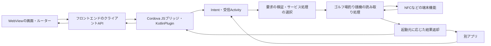

# WebView・クライアントAPI・Kotlinブリッジの仕様

[ドキュメント一覧](README.md) · [現在の暫定Navigation実装](SERVICE_NAVIGATION.md) · [プラグインの実装](../kotlin-plugin/README.md)

更新日: 2026-10-27。この文書を構成方針とサービス仕様の参照元とします。確定した要件、今回の設計方針、現在の実装、未確定事項を区別して記載します。

WebMessageによる双方向通信と[セキュリティレビュー](WEBVIEW_BRIDGE_REVIEW.md)の対策を実装方針とします。CordovaPluginによるActivity起動と、そのActivity内の標準WebViewで使う通信方式を区別します。Vueの画面切り替え・既存ソースの再利用・成果物の配布は[VUE_WEBVIEW_INTEGRATION.md](VUE_WEBVIEW_INTEGRATION.md)にまとめています。手書きHTMLによる[通信サンプル](WEBVIEW_BRIDGE_SAMPLE.md)は実装しました。Vue連携は未実装です。

## 確定している前提

- 基本の画面表示・画面遷移はVueを使うWebView内で行います。起動元のCordova WebViewと、起動先のfeature内の標準WebViewを区別します。
- フロントエンドからクライアントAPIを呼び、Kotlinで実装したCordovaのJSブリッジが処理ID・引数を受け取ります。
- Activityの起動経路は、CordovaからCordovaPluginを経由する起動と、別アプリからの起動の2種類です。
- 通常のテキスト・ボタン・操作案内などのUIはWeb側が担当します。現在のネイティブ画面のテキスト・ボタンは動作確認用の暫定配置です。
- Kotlin側はサービス単位で処理をまとめます。サービスの例はゴルフ場釣り銭機、本人確認（マイナンバー）です。
- NFC・Cameraは各サービスが利用する端末機能として扱います。
- 現時点で確定している業務処理は、ゴルフ場ID・ホルダー番号の読み取りです。NFC書き込みは対象外です。

[開発用dev-app](FEATURE_DEVELOPMENT.md)から同一APK内のMainActivityへIntentサンプルを渡すこともできます。これは開発ホスト内の検証経路で、以下の別アプリ向け業務受付は引き続き未実装です。

## Activityの起動要件

| 起動元 | 経路 | 実装状況 |
| --- | --- | --- |
| CordovaのWebフロントエンド | クライアントAPI → cordova.exec → KotlinPlugin → Intent → Activity | 暫定実装でActivity起動と要求の受け取りを確認済み。実際のサービス処理・結果返却は未実装 |
| 別アプリ | 呼び出し元アプリ → Intent → 受信Activity | 起動要件として確定。外部からサービス要求を受け付ける入口・公開契約は未実装 |

別アプリからの起動はCordovaPluginを経由しません。どちらの経路も、受信した要求を共通の処理ID・型付き引数へ変換し、サービスの処理へ渡す方針です。外部アプリ用のIntentのaction・extra・データ形式は未確定です。

Activityは起動要求を受け付け、処理の実行やライフサイクルを仲介する役割を持ちます。独自のテキスト・ボタン・複数画面を設けるかどうかは、Activity起動とは別に判断します。

### 共通の受信処理

- 初回起動とActivity再利用時の新しいIntentの双方で、処理ID・引数を検証します。
- 経路に応じた呼び出し元の確認を行ったうえで、検証済みの要求をサービス処理へ渡します。
- サービス処理は共通化し、起動元に応じた結果の受け渡しを入口側で扱います。
- サービスの読み取り処理と、Activity・Web画面の復元を区別します。再生成だけで機器処理を再実行する前提にはしません。

通信検証とサービス画面用の標準WebViewは、既存のfeatureのMainActivityに配置する方針です。新しいActivityは追加しません。別アプリ向けの公開入口を同じActivityにするか、将来別の受信コンポーネントを設けるかは、公開契約に合わせて別途決めます。

### 外部アプリ向けの公開と結果返却

現在の`dev.example.nativefeature.MainActivity`は`exported=false`で、通常の別アプリからこのサービスActivityを直接起動できません。別アプリ起動への対応時には、外部公開する入口と許可する呼び出し元を決めます。同一署名の連携アプリに限定するか、異なる署名のアプリも対象にするかは未確定です。呼び出し元の条件に合わせて公開設定・権限・検証方法を設計します。[Activityの公開設定](https://developer.android.com/guide/topics/manifest/activity-element#exported)

別アプリへの結果返却は、Activity Resultなどを候補に、呼び出し側との契約を決めます。結果が不要な起動も許可するか、取消・失敗・呼び出し元の再生成をどう扱うかは未確定です。Cordova側のJSコールバックとは区別します。[Activityの結果受け取り](https://developer.android.com/training/basics/intents/result)

## 構成方針



| 担当 | 責務 |
| --- | --- |
| Webの画面・ルーター | 表示、画面遷移、読み取り案内、待機・結果・エラーのUI |
| フロントエンドのクライアントAPI | 型付きの要求生成、環境ごとの通信アダプター、非同期結果の受け取り。起動元のCordova通信と起動先のWebMessage通信を分ける |
| KotlinPlugin | Web要求の受信・検証、IntentによるActivity起動、結果・エラーのWeb返却、プラグインのライフサイクル連携 |
| 受信Activity | 両起動経路の要求を共通の型へ変換・検証し、サービス処理を呼ぶ。起動元への結果返却とライフサイクルを仲介する |
| サービスごとの処理 | ゴルフ場釣り銭機などの業務処理、入力・取得データの解釈 |
| 端末機能の実装 | NFC読み取りなどの機器操作、接続・リスナー等の管理 |
| 必要時のネイティブUI | Android・利用SDK・業務要件から必要になった表示やユーザー操作 |

この図と責務表は実装先の設計方針です。受信Activityの共通化と外部アプリへの結果返却方式は未確定です。現在のAPIは暫定画面を起動する段階で、別アプリ向けのサービス受付と機器処理の結果返却は未実装です。

Activity内に配置する標準WebViewとKotlinの通信には、`WebViewCompat.addWebMessageListener()`・`JavaScriptReplyProxy.postMessage()`を使います。ローカルのVue成果物はWebViewAssetLoaderで配信します。このWebView内の通信にはCordova通信API・addJavascriptInterface・AIDLを使わず、evaluateJavascriptへ依存しません。起動元でのCordovaPlugin利用は維持します。

## ネイティブ側のNavigationを設ける範囲

基本構成では、Activityが受け取った処理IDからサービスの処理を選びます。Activityを起動する場合も、独自の複数画面を表示しなければ、NavHost・画面ルート・画面ごとのViewModelを必須にしません。Webの画面履歴はWeb側で管理します。

| 状況 | ネイティブ側の扱い |
| --- | --- |
| CordovaPluginまたは別アプリからActivityを起動して端末機能を実行する | 受信Activityを入口にサービス処理を呼ぶ。Activity起動だけでは業務画面用のNavigationは不要 |
| OSの権限確認、システム画面、SDK固有画面が必要になる | 必要な起動・結果受け取りを実装する。単一画面の利用だけでNavHostを追加する必要はない |
| 複数の独自ネイティブ画面を順に表示する要件ができる | そのサービス内の画面遷移に限定してNavigationを設ける |

サービスごとのフォルダ分割は、専用のNavigationがない場合にも適用します。`services/golfchange/`にサービスの処理をまとめ、ネイティブUIが必要になれば同じサービスの画面・Navigationを追加します。本人確認は独立したサービスとして扱います。

### Activity・Intent・SavedStateHandle

- Activity起動は、CordovaPlugin経由と別アプリ経由の両方に対応する要件です。受信ActivityとIntentを起動の入口として設計し、その内部の画面遷移の有無を別途判断します。
- 例えばAndroidのNFC Reader ModeはActivityを指定し、そのActivityが前面にある間に動作するAPIです。読み取り中にどのActivityを前面に置くかは、受信Activity・WebViewの配置とカード仕様・使用SDKに合わせて決めます。[NfcAdapter.enableReaderMode](https://developer.android.com/reference/android/nfc/NfcAdapter#enableReaderMode(android.app.Activity,android.nfc.NfcAdapter.ReaderCallback,int,android.os.Bundle))
- 独自ネイティブ画面を持つ場合には、画面用ViewModel・Navigation・SavedStateHandleを使って画面状態や引数を復元できます。
- UIを持たないサービス呼び出しの引数は、受信Activityで検証した要求としてサービス処理へ渡します。SavedStateHandleを引数の必須受け渡し先にはしません。
- 独自のSTATE_REQUESTは導入しません。画面の復元と端末処理の再実行は分けて設計します。

これらは本プロジェクトの設計判断です。Cordova自体は`cordova.exec`からプラグインの`execute`へ要求を渡し、コールバックで結果を返す構成を提供します。[Cordova Androidプラグインの公式仕様](https://cordova.apache.org/docs/en/latest/guide/platforms/android/plugin.html)

## 要求の形

サービスへ渡す共通の要求は、処理IDと任意の引数オブジェクトを持ちます。WebのクライアントAPIもこの形を使用します。別アプリのIntentから同じ型へ変換するための公開形式は、別途決めます。

```json
{
  "id": "golf-change.read-holder",
  "args": {}
}
```

| 項目 | 扱い |
| --- | --- |
| `id` | 必須のString。サービスと処理を表す識別子。呼び出しごとの一意な番号とは別の概念 |
| `args` | 任意のJSONオブジェクト。省略と空オブジェクトを区別する。現在の型はJsonObject?で、nullも未指定として扱う |

サービスごとに引数の項目が決まったら、フロントエンドとKotlin双方で専用の型・検証を定義します。現在のJsonObjectはオブジェクトであることを保証し、内部フィールドの仕様までは保証しません。

現在の業務用処理IDは`golf-change.read-holder`です。`home`はネイティブ画面、`sample.webview`はWebMessage通信の確認用です。`nfc.read`・`nfc.write`・`camera.capture`は受け付けません。

## ゴルフ場釣り銭機サービス

| 項目 | 仕様・状態 |
| --- | --- |
| サービス | ゴルフ場釣り銭機 |
| 現在の処理ID | `golf-change.read-holder` |
| 確定した処理内容 | ゴルフ場ID・ホルダー番号の読み取り |
| 読み取り対象の2項目 | 取得するデータとして扱う。Webから渡す必須引数にはしない |
| `args` | 任意。業務用の具体的な項目は未確定 |
| 通常の案内・結果表示 | WebView側が担当する方針 |
| NFC書き込み | 対象外 |
| SLIの判定・座標読取 | dataへ実装。実タグ検証は未実施 |
| ゴルフ場番号 | ブロック1 Byte 0〜1、LSBファーストのInt、0..65535。ユースケース実装済み |
| ホルダー番号 | ブロック1 Byte 2〜ブロック4 Byte 3の14バイト。合意した暫定方式として大文字・区切りなし28桁の16進String。ユースケース実装済み |
| NFC検出・読取の画面接続・Web返却 | 未接続 |

ICODE SLIを対象とし、Android NfcV APIで読み取ります。他タグ・書き込み・認証処理は追加していません。固定メモリ位置とゴルフ場番号のLSBファーストは確定しています。ホルダー番号は「任意の書式」という情報だけのため、合意した暫定方式として元バイトを保つ28桁の16進文字列で返します。文字コード・パディングを推測して変換・削除はしません。詳細は[NFCの読取実装](NFC_READING.md)を参照してください。Webへ返す正式な結果フィールド名は未確定です。

本人確認（マイナンバー）は追加候補のサービスです。処理ID・取得項目・引数・結果・必要なUIなどの個別仕様は未確定です。

## 結果と実行中の状態

CordovaのクライアントAPIとして実装する際は、サービスの処理完了後に結果またはエラーをWebへ返す方針とします。別アプリからの要求には、その起動契約に応じた経路で結果を返します。現在の`openFeature`の成功通知はActivityの起動要求が完了したことだけを表します。読み取り結果を受け取れるAPIとしては、まだ利用できません。

| 場面 | 設計上の扱い |
| --- | --- |
| 実行中 | Webで待機状態を表示する。処理の寿命・停止・端末資源の解放はKotlin側でも管理する |
| 正常終了 | 起動元に応じて結果を返す。Cordova経由ではWeb側が表示・遷移を行う。別アプリ向けの契約は未確定 |
| エラー・取消・タイムアウト | Webへ区別できる結果を返す。形式・コード・時間はAPI実装前に決める |
| Webのフルページ遷移・再読み込み・破棄 | 古い要求やコールバック・端末リスナーの扱いを定義する。CordovaのonReset・onDestroyなどと連携する |
| SPA内の画面遷移 | Webルーターから実行中処理の取消・結果受け取り方針を連携する。プラグインのonResetだけに依存しない |
| Activity再生成・プロセス終了 | 自動で機器処理を再実行する前提にしない。継続可否・再試行・Webとの状態同期を決める |

CordovaはWebViewのページ遷移・再読み込み時の`onReset()`を提供します。SPA内の遷移も含めた具体的な取消API・多重実行・要求の相関管理は未確定です。[Cordovaプラグインのライフサイクル](https://cordova.apache.org/docs/en/latest/guide/platforms/android/plugin.html#plugin-initialization-and-lifetime)

## 現在の暫定実装との差分

| 項目 | 現在の実装 | 本仕様の構成方針 |
| --- | --- | --- |
| Webの入口 | `KotlinPlugin.openFeature` | フロントエンドのクライアントAPI。正式なメソッド名は未確定 |
| 別アプリからの入口 | サービスActivityはexported=falseで、外部向けのサービス受付は未実装 | 公開する受信Activity・Intentの契約・呼び出し元の許可条件を定義する |
| 要求の解決 | FeatureLaunchRequest.toDestination()で画面を選ぶ | 型付き要求からサービスの処理を選ぶ。画面が必要な処理ではUI起動へ接続する |
| 起動・受信後の動作 | CordovaPluginがIntentでMainActivityを起動する | CordovaPluginと別アプリの両経路からActivityで要求を受け、サービス処理を実行する |
| Navigation | 共通NavHostとGolfChangeNavigation | 独自ネイティブ画面の遷移が必要な範囲に設ける |
| 引数の受け取り | 画面用ViewModelのSavedStateHandle | 通常は検証した要求をサービスへ渡す。画面を持つ場合に画面状態の復元を使う |
| テキスト・ボタン | ネイティブ側にも暫定配置 | 通常のUIはWeb側で配置する |
| 成功・結果返却 | CordovaへActivity起動要求の完了を通知 | サービス処理の完了と取得結果を起動元に応じた契約で返す |

業務の暫定画面に加え、`sample.webview`で固定HTMLの通信サンプルを表示します。既存の依存版・起動経路を維持しています。現行実装の詳細と過去の確認結果は[SERVICE_NAVIGATION.md](SERVICE_NAVIGATION.md)を参照してください。

## 実処理の実装前に決める事項

Web側への事前質問は[WEB_TEAM_QUESTIONS.md](WEB_TEAM_QUESTIONS.md)を参照してください。Vue組み込み検証前の確認と、業務API実装までの確認を分けています。

- 正式なホルダー番号の文字コード・パディング等の業務書式。現時点の合意は28桁の16進文字列による暫定表現。ICODE SLI・固定座標・ゴルフ場番号のLSBファーストは確定済み。
- 正式なクライアントAPI名、サービス固有の引数・結果の型、エラー・取消・タイムアウトの契約。
- 外部アプリ用の公開入口、Intentのaction・extra・データ形式。標準WebViewの配置先は既存featureのMainActivityとする。
- 外部公開する入口、許可する呼び出し元、公開設定・権限、別アプリへの結果返却方式。
- Webの画面遷移やバックグラウンド移行時の継続・取消、多重呼び出し、再試行の扱い。
- 実機能・SDKが必要とする権限・専用UIと、読み取り中のActivityのライフサイクル。
- 既存Vueソースの配置先・版・ビルド定義、再利用範囲、配布先ごとの通信アダプターと認証の受け渡し。

これらを確定してから、暫定画面を起動する実装をサービス実行へ置き換えます。
