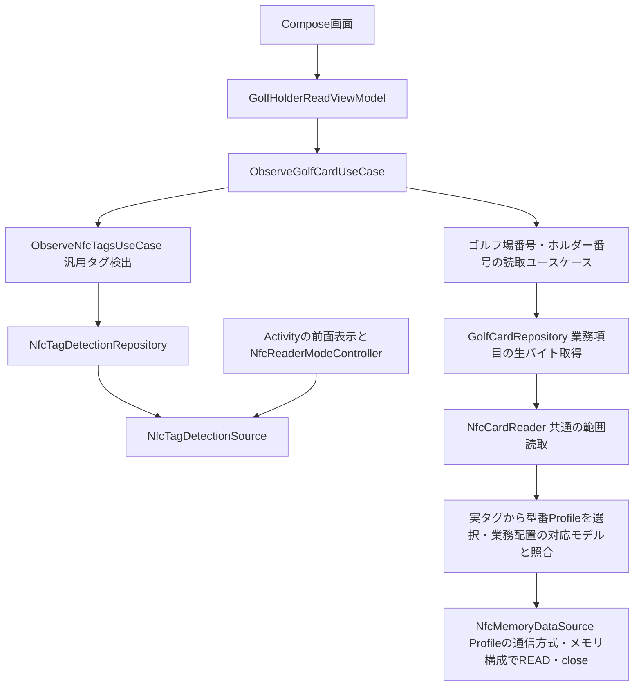

# 汎用タグ検出と業務Repositoryの構成

[ドキュメント一覧](README.md) · [読取仕様・検証](NFC_READING.md)

更新日: 2026-10-28。汎用タグ検出、対象に紐づく引数なしのRepository、ゴルフ用ユースケースと画面への接続を実装しています。読取対応製品は引き続きICODE SLIだけです。型番Profileから通信方式・メモリ構成を選ぶ経路を実装しています。その他のRF・型番、認証・保護領域は将来の検討事項です。

## 責務と依存方向



UI・ViewModelはRepositoryを直接呼びません。ViewModelは業務ユースケースを購読して画面状態へ反映します。ActivityはAndroid固有のReaderModeの有効化・解除だけを担当し、業務の読み取り順序・Repository生成・エラー処理には関与しません。

| 配置 | 責務 |
| --- | --- |
| [data/nfc](../native/data/src/main/kotlin/dev/example/nativedata/nfc/) | 汎用検出の契約・実装、Androidの検出ホスト、対象参照、型番Profile・範囲検査・通信、共通の失敗契約 |
| [feature/nfc](../native/feature/src/main/kotlin/dev/example/nativefeature/nfc/) | ゴルフに依存しない検出ユースケースと、その発生元を示す検出エラー |
| [data/card](../native/data/src/main/kotlin/dev/example/nativedata/card/) | 業務ごとのRepository生成の入口。共通NFCのFactoryへ生成を委譲する |
| [data/golf](../native/data/src/main/kotlin/dev/example/nativedata/golf/) | 業務Repositoryの契約・生成、固定座標の解決、生バイトの取得 |
| [feature/services/golfchange](../native/feature/src/main/kotlin/dev/example/nativefeature/services/golfchange/) | 同じタグからの2項目取得、Int・Stringへの解釈、ゴルフの画面状態と表示 |

別の業務でも`ObserveNfcTagsUseCase`を再利用できます。検出Repositoryが`GolfCardRepository`を返す構成にはしていません。検出と業務の読み取りをつなぐのは各業務のユースケースです。

## NFC配下の配置

共通の生バイト読取は`NfcCardReader`、接続・送受信・応答検査は`NfcMemoryDataSource`と呼びます。業務データを扱う`GolfCardRepository`等の名前は維持しています。今回の改名と配置整理では、読取順序・判定条件・対象の寿命・排他・エラー契約は変更していません。

`native/data/src/main/kotlin/dev/example/nativedata/nfc/`を次の責務で分けています。テストも同じ分類とし、共用の模擬タグ・エラーFactory等は`src/test/.../nfc/testing/`、業務Repositoryのテストは`src/test/.../golf/`に置きます。

| ディレクトリ | 主な内容 |
| --- | --- |
| `detection/` | 検出契約・対象参照・検出Source・ReaderMode制御・検出失敗 |
| `profile/` | 型番・通信方式・メモリ構成の型、判定器の契約と共通Resolver |
| `profile/icodesli/` | SLI固有のProfileと判定器 |
| `reader/` | `NfcCardReader`の契約・Default実装・生成Factory |
| `memory/` | `NfcMemoryDataSource`、座標・範囲・メモリ構成、Android接続API |
| `failure/` | 読取失敗の共通interface・Factory、例外の分類処理 |
| `di/` | Repository・業務Factoryのbindingと型番判定器のSet登録 |

## 対象参照と引数なしAPI

検出ユースケースは`Flow<Result<DetectedNfcTag, ObserveNfcTagsErr>>`を返します。`DetectedNfcTag`は対象を指す不透明な参照で、型番・RF技術・AndroidのTag・接続APIを公開しません。型番を選ぶ責務をユースケースへ渡しません。

`ObserveGolfCardUseCase`は検出した参照を`GolfCardReadUseCaseFactory`へ渡します。featureのFactoryはdataの`CardRepositoryFactory.createGolfCard()`を呼び、そのRepositoryを各読取ユースケースへ注入します。業務ごとの生成メソッドを追加できる窓口とし、IC型番から業務カードの種類を推測しません。

```kotlin
// 2つとも同じ検出対象から生成する。型番・座標・接続を呼出側へ渡さない。
val course = readers.courseNumber(target)()
val holder = readers.holderNumber(target)()
```

実装ではゴルフ場番号が失敗した時点で今回の処理を終えます。ホルダー番号も成功した場合だけ完了イベントを通知し、部分成功や別カードの値を組み合わせません。

```kotlin
/** 生成時に固定した対象から、業務項目の生バイトを取得する。 */
interface GolfCardRepository<out E : NfcReadFailure> {
    suspend fun readGolfCourseNum(): Result<ByteArray, E>
    suspend fun readGolfCardHolderNum(): Result<ByteArray, E>
}
```

戻り値は2バイト・14バイトです。ゴルフ場番号のLSBファーストIntへの変換、ホルダー番号の28桁の大文字16進Stringへの変換は、それぞれの読取ユースケースに残しています。

## 型番Profileと通信方式

[dataのNfcTagProfile](../native/data/src/main/kotlin/dev/example/nativedata/nfc/profile/NfcTagProfile.kt)へ、モデル・通信方式・ユーザーメモリ構成をまとめています。共通の`DefaultNfcCardReader`が、登録された判定器を持つ`NfcTagProfileResolver`を通して実タグからProfileを選び、内部の[NfcMemoryDataSource](../native/data/src/main/kotlin/dev/example/nativedata/nfc/memory/NfcMemoryDataSource.kt)へ1つの仕様情報として渡します。

| モデル | Profile内の通信方式 | 必要なAndroid技術 | ユーザー領域 |
| --- | --- | --- | --- |
| ICODE SLI | ISO/IEC 15693 | NfcV | 28ブロック×4バイト、ブロック0〜27 |

通信方式をユースケースから別途指定したり、型番と方式を呼出側で組み合わせたりしません。Profileとモデルの型はdataモジュールのinternalです。DataSourceも実タグの技術・モデルとProfileの対応を確認してから接続します。

共通Reader内の呼び出しは次の形です。`profile`に方式とメモリ構成が含まれるため、通信方式やブロック幅の引数を重ねて渡しません。

```kotlin
memoryDataSource.read(
    tag = target.access,
    profile = profile,
    range = range,
    failures = failures,
)
```

範囲検査・バイト数計算・ブロック境界の切り出し・正常応答の長さはProfileのメモリ構成を参照します。ISO 15693の送受信ではUID付きSingle Block READだけを実装し、ブロック番号が1バイトに収まらない拡張READへ自動では切り替えません。

型番Profileと業務レイアウトは別の責務です。モデルが一致しても、発行サービスの配置が同じとは限りません。ゴルフの固定座標はdata/golfで管理し、`DefaultGolfCardRepository`が配置の対応モデルを`expectedModel`として共通Readerへ渡します。共通側で実タグと照合するため、将来別モデルへ対応してもSLI用の座標を無条件に流用しません。現在登録されているSLI判定器はTagのメタデータだけを使い、追加のRFコマンドを送りません。共通ResolverはUIDの書式を固定せず、型番ごとの判定器をHiltのSetで受け取ります。[追加手順と共通部の責務](NFC_TAG_IDENTIFICATION.md)を参照してください。

共有済みTagInfoの転記は`ICODE SLI(SLI2ICS20)`で、資料の表記は`SL2 ICS20`です。原レポートとの照合待ちの正式品番を確定値としてコードへ登録せず、`ICODE_SLI`として扱います。28×4バイトのユーザー領域とISO 15693対応は[NXPのSLI仕様 §1.1・§3.2](https://www.nxp.com/docs/en/data-sheet/058031.pdf)と照合しています。

## FactoryとReader・Repository実装の分離

生成と読取の実装は別ファイルです。公開する業務Factoryの契約も、実装と分けています。

| ファイル | 担当 |
| --- | --- |
| [CardRepositoryFactory.kt](../native/data/src/main/kotlin/dev/example/nativedata/card/CardRepositoryFactory.kt) | 業務カードの生成契約。現在は`createGolfCard()`を提供 |
| [DefaultCardRepositoryFactory.kt](../native/data/src/main/kotlin/dev/example/nativedata/card/DefaultCardRepositoryFactory.kt) | 共通NFCのFactoryを使い、業務Repositoryを生成する |
| [NfcCardReaderFactory.kt](../native/data/src/main/kotlin/dev/example/nativedata/nfc/reader/NfcCardReaderFactory.kt) | 対象タグ・エラーFactory・DataSourceを組み合わせて共通Readerを生成する |
| [DefaultNfcCardReader.kt](../native/data/src/main/kotlin/dev/example/nativedata/nfc/reader/DefaultNfcCardReader.kt) | 対象の有効期間・排他・Profile識別・モデル照合・範囲読取を担当する |
| [DefaultGolfCardRepository.kt](../native/data/src/main/kotlin/dev/example/nativedata/golf/DefaultGolfCardRepository.kt) | ゴルフの項目を範囲と対応モデルへ変換し、共通Readerへ委譲する |
| [GolfCardField.kt](../native/data/src/main/kotlin/dev/example/nativedata/golf/GolfCardField.kt) | SLIで発行された業務カードの固定座標を管理する |
| [DefaultNfcTagDetectionRepository.kt](../native/data/src/main/kotlin/dev/example/nativedata/nfc/detection/DefaultNfcTagDetectionRepository.kt) | 検出Sourceの通知を、呼出元固有の検出結果へ変換する |

`DefaultCardRepositoryFactory.createGolfCard()`の組み立ては次のとおりです。

```kotlin
val nfcReader = nfcReaders.create(target, failures)
return DefaultGolfCardRepository(nfcReader)
```

生成時には通信しません。Profileの識別は共通Readerの読取時に行い、識別で起きる失敗も指定されたユースケースのエラーFactoryで直接生成します。Factoryがタグや生成済みRepositoryをキャッシュすることもありません。

`NfcCardReader`とそのFactory・実装はdata内部の型です。featureは公開された`CardRepositoryFactory`と業務Repositoryの契約を使い、物理範囲・モデル・通信方式へ依存しません。現時点で生成対象の業務カードはゴルフだけで、社員証等の例示用の実装は追加していません。

## 保持する範囲と寿命

- 専用Sessionクラス、Session保存用の管理クラス、Hiltの独自Componentは作りません。検出対象を短命なRepositoryへ関連付けるだけです。
- `NfcTagDetectionSource`はアプリ共通の検出要求の仲介役ですが、Activityや最後のタグをフィールドへ保存しません。検出結果のreplayや永続化も行いません。
- 実際の対象参照は購読処理内で保持します。その検出通知に対する下流のmap・collectの処理が戻ったとき、または購読が終了したときに無効化します。終了した参照への新しい読取は`TargetExpired`で拒否します。
- 同じタグへの読取はMutexで直列化します。対象の保持とRF接続の保持は別で、各項目の読取ごとにconnect・closeします。
- 追加タグは受信待ちのときだけ受け付けます。読み取り中の検出を蓄積せず、同じ処理の途中で対象を差し替えません。対象は検出通知の処理内で使い切ります。firstで参照を持ち出したり、検出Flowへbuffer・conflate・shareIn等を追加して処理を切り離したりしないでください。
- 複数の検出購読は直列化します。画面ではRESUMEDの間だけ購読し、購読終了で要求を解除します。

Hiltは`CardRepositoryFactory`を`DefaultCardRepositoryFactory`へ`@Binds`し、内部の`NfcCardReaderFactory`・Readerの依存であるDataSourceは`@Inject constructor`で生成します。`@Singleton`は検出要求の仲介役と、判定器の集合を持つResolverに使い、タグに紐づくReader・業務Repositoryへは付けません。ResolverはTagや識別結果を保存しません。ReaderModeの制御は`@ActivityScoped`です。タグごとにユースケースを組み立てるFactoryはfeature側にあり、dataからfeatureへの逆依存は作りません。

ReaderModeの解除と、通信接続のcloseは別の責務です。実行中のブロッキングI/Oをキャンセル時に即時closeする仕組みは追加していません。現在はブロック間で取消を確認し、I/Oが戻ってから解放・取消伝播します。

## エラーと画面通知

検出の失敗は`ObserveNfcTagsErr.NfcDetection.NotSupported`・`Disabled`・`AccessDenied`です。NFC設定変更を監視し、無効から有効へ戻ったら検出を再開します。

読取は従来どおり`ReadGolfCourseNumberErr.NfcRead.*`・`ReadGolfHolderNumberErr.NfcRead.*`を直接生成します。購読の終了等で対象の有効期間が終わった場合に`TargetExpired`を追加しました。物理的な離脱を表す`TagLost`と区別します。

`GolfCardReadEvent`は検出失敗・ゴルフ場番号失敗・ホルダー番号失敗・両項目の取得完了を通知します。失敗値は元のユースケースの具体型のままで、エラー型を合わせるための変換は行いません。失敗後も次のカード検出を待ちます。独自アノテーション・エラー生成用KSPは使いません。

画面は検出待ち・NFC利用不可・番号・失敗時の案内を表示します。番号をログへ出力しません。Web・Cordovaへの業務結果返却は引き続き未実装です。

## 今後の拡張

現在はICODE SLIのProfileと、Profileを受け取る`NfcMemoryDataSource`のISO 15693経路を実装しています。旧`IcodeSliMemoryReader`は置き換えました。型番ごとのRepository・Readerや、未確定製品のProfile・鍵・認証は追加していません。

他製品へ対応するときは、業務項目のAPIを保ち、型番の識別条件・Profile・発行書式に応じた業務レイアウトを追加します。現状のメモリ形状は均一なブロックだけなので、ページ・セクタ・サービス等の座標や保護領域は対象仕様が確定してから拡張します。通信経路が増えて独立した検証が必要なら、手順単位のDataSourceへ分離します。RF技術だけからコマンド・認証方式を決めません。

| 対象例 | 将来確認する読み取り座標・条件 |
| --- | --- |
| ICODE SLI／NFC-V | 現在対応済み。ユーザー領域のブロック番号・バイト位置 |
| MIFARE Ultralight等 | ページ・バイト位置、一括読取単位、末尾・読取不可領域 |
| MIFARE Classic | セクタ・ブロック・バイト位置、セクタごとの認証・アクセス条件 |
| FeliCa | システム・サービス・ブロック・バイト位置、アクセス方法・認証 |
| ISO-DEP上のファイル方式 | 上位プロトコル・アプリケーション・ファイル・バイト位置 |

保護領域の選択だけで読取権限を得られるとは扱いません。仕様と鍵の取得方法が確定してから対応経路と具体エラーを追加します。認証状態・接続の共有や複雑な排他・中断管理が必要になった時点で、専用Sessionクラスの価値を再検討します。

参考: [Android ReaderMode](https://developer.android.com/reference/android/nfc/NfcAdapter)、[Android TagTechnology](https://developer.android.com/reference/android/nfc/tech/TagTechnology)、[Hilt Custom Components](https://dagger.dev/hilt/custom-components.html)。

## 生成・実装分離の検証

両ホストのビルド・単体テスト・Lint・静的解析と、共通Readerの範囲読取・排他・エラー文脈を確認しました。[検証記録](logs/card-repository-factory/README.md)を参照してください。

2026-10-28の改名・配置整理では、着手時のKotlinコードと照合し、命名・package・import・コメント・整形以外の処理差分がないことを確認しました。native・Cordovaの両ホストで、Debug／Releaseそれぞれdata 72件・feature 46件の単体テストがすべて成功しました。開発アプリのDebugとCordovaのDebug／ReleaseのAPKビルド、Android Lint、detekt・整形チェック、nativeのKDoc生成も成功しています。
